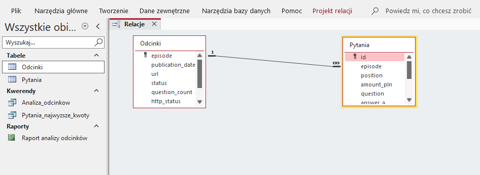
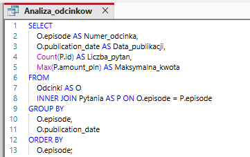
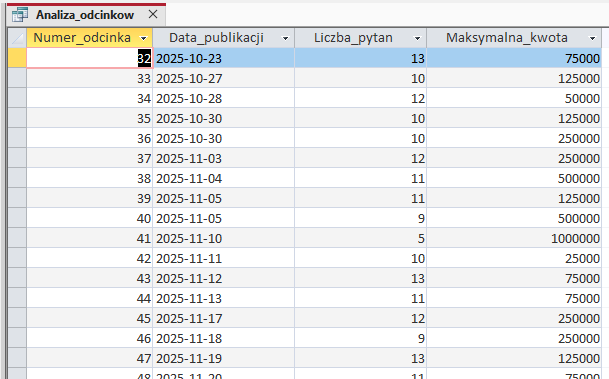
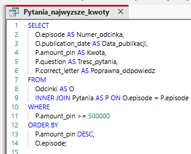
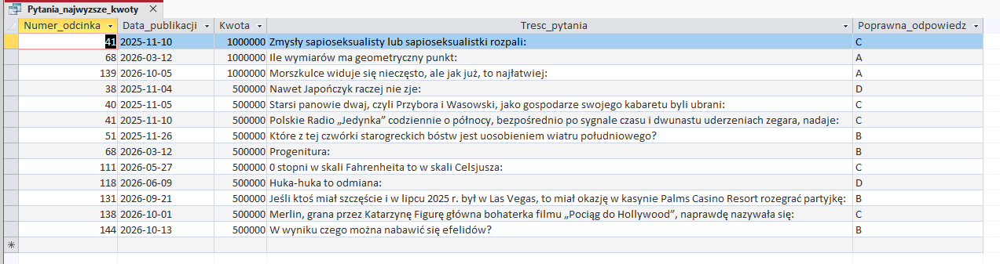
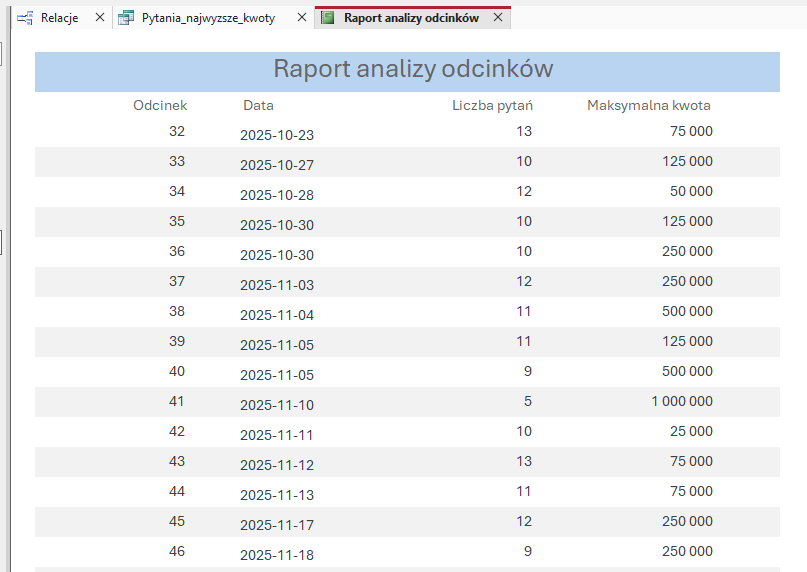

# Automatyzacja pozyskiwania i analizy danych z teleturnieju „Milionerzy”

**Python · Web Scraping · SQLite · SQL · Microsoft Access · Excel · Power Query · tabele przestawne · kontrola jakości danych · raportowanie PDF**

## 1. Problem i cel

Pytania i odpowiedzi z teleturnieju „Milionerzy” są publikowane w osobnych artykułach na stronie Polsatu. Ręczne zbieranie i porządkowanie informacji z wielu publikacji jest czasochłonne i podatne na błędy.

Celem projektu było **zautomatyzowanie pozyskiwania, weryfikacji i raportowania danych**, a następnie wykorzystanie zgromadzonego zbioru do analiz w Microsoft Excel i Access.

## 2. Rozwiązanie

Przygotowany w Pythonie system realizuje sześć etapów:

1. **Wyszukiwanie** — automatyczne odnajdywanie artykułów dotyczących kolejnych odcinków.
2. **Ekstrakcja** — pobieranie pytań, wariantów odpowiedzi, poprawnych odpowiedzi i kwot.
3. **Archiwizacja** — zapisywanie rekordów w SQLite i eksport do CSV.
4. **Kontrola jakości** — wykrywanie brakujących wartości, niespójności i duplikatów.
5. **Analiza statystyczna** — obliczanie rozkładów odpowiedzi, kwot i statystyk odcinków.
6. **Raportowanie** — automatyczne generowanie raportu PDF z tabelami, wykresami i wnioskami.

### Przykład pozyskanych danych

Każde pytanie jest osobnym rekordem zawierającym numer odcinka, kwotę, treść pytania, cztery warianty odpowiedzi i poprawny wariant.

*Fragment uporządkowanego zbioru danych wyeksportowanego do CSV.*

## 3. Rezultaty

*Przykładowy przebieg automatycznego pobierania i przetwarzania danych.*

## 4. Kontrola jakości i raportowanie PDF

Moduł walidacji sprawdza kompletność rekordów, poprawność oznaczeń odpowiedzi, spójność liczby pytań oraz występowanie identycznych pytań po normalizacji tekstu.

Na podstawie danych SQLite program automatycznie generuje raport PDF ze statystykami, wykresami i wynikami kontroli jakości.

W analizowanym zbiorze najczęściej występowała poprawna odpowiedź **B (359 przypadków)**, a najrzadziej **A (252 przypadki)**.

*Fragment raportu PDF wygenerowanego w Pythonie.*

**[Zobacz pełny raport analityczny PDF](reports/raport_milionerzy.pdf)**

## 5. Interaktywna analiza danych w Microsoft Excel

Dane zaimportowano do Microsoft Excel za pomocą **Power Query**, a następnie przygotowano tabele przestawne i interaktywny dashboard.

Panel przedstawia liczbę pytań i odcinków, średnią liczbę pytań na odcinek, rozkład poprawnych odpowiedzi oraz liczbę pytań według kwot.

*Dashboard prezentujący statystyki całego zbioru 1 229 pytań.*

**Fragmentator** pozwala filtrować oba wykresy według wybranych odcinków.

*Przykład analizy trzech odcinków. Wykresy aktualizują się po zastosowaniu filtra, natomiast górne wskaźniki przedstawiają statystyki całego zbioru.*

**[Pobierz skoroszyt z interaktywnym dashboardem](spreadsheets/Milionerzy_Analiza.ods)**

## 6. Relacyjna baza danych i analiza w Microsoft Access

Dane wykorzystano również do utworzenia bazy Microsoft Access, zawierającej tabele **Odcinki** i **Pytania**, połączone relacją jeden-do-wielu z wymuszoną integralnością referencyjną.

*Relacja 1:N umożliwia powiązanie każdego pytania z odpowiednim odcinkiem.*

### Przykłady zapytań SQL

**1. Analiza statystyk poszczególnych odcinków**

*Połącz tabele Odcinki i Pytania według numeru odcinka. Dla każdego odcinka policz liczbę pytań, znajdź najwyższą przypisaną kwotę i uporządkuj wyniki według numerów odcinków.*

*Wynik: zestawienie numerów odcinków, dat publikacji, liczby pytań i maksymalnych kwot.*

**2. Wyszukiwanie pytań o najwyższych kwotach**

*Połącz tabele Odcinki i Pytania. Wybierz pytania o wartości co najmniej 500 000 zł, wyświetl ich treść, poprawną odpowiedź i informacje o odcinku. Posortuj wyniki malejąco według kwoty, a następnie rosnąco według numeru odcinka.*

*Wynik: lista pytań o najwyższych kwotach wraz z informacjami o odcinkach i poprawnych odpowiedziach.*

### Raport Microsoft Access

Na podstawie kwerendy `Analiza_odcinkow` przygotowano wielostronicowy raport prezentujący liczbę pytań i maksymalne kwoty dla poszczególnych odcinków.

*Fragment raportu analitycznego przygotowanego w Microsoft Access.*

**[Pobierz bazę Microsoft Access (.accdb)](database/Milionerzy_Analiza.accdb)**

**[Zobacz pełny raport Access w PDF](reports/Raport_Access.pdf)**
## 7. Praktyczne zastosowanie

Projekt pokazuje pełny proces pracy z danymi: **od automatycznego pozyskiwania informacji, przez ich kontrolę i przechowywanie, po analizę i prezentację wyników**.

Łączy programowanie w Pythonie z praktycznym wykorzystaniem **SQL, Microsoft Access, Power Query, tabel przestawnych i raportowania**. Podobne podejście można zastosować do automatyzacji powtarzalnych zadań analitycznych i przygotowywania zestawień biznesowych.
