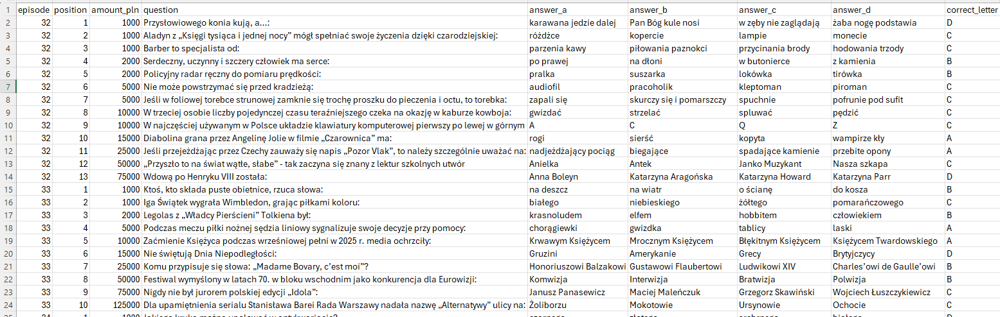
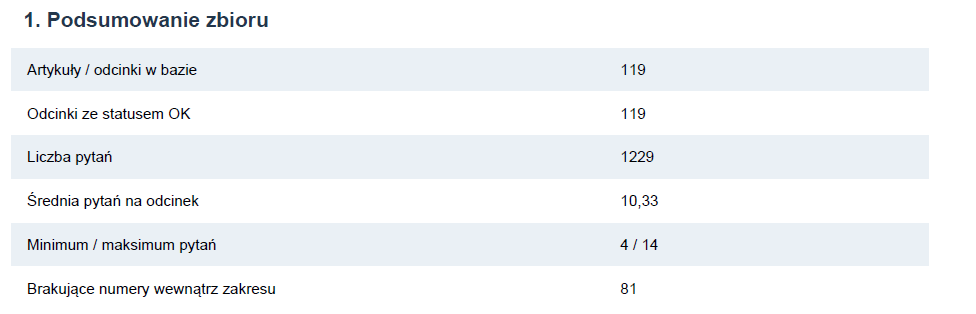
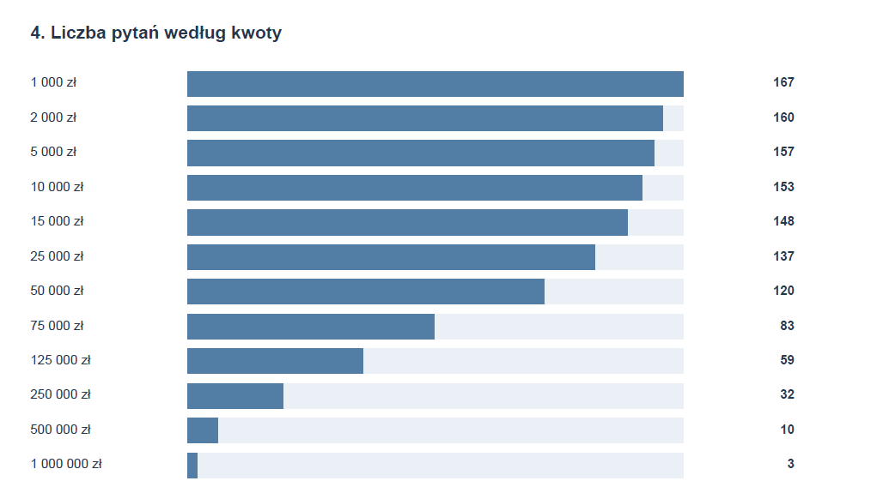
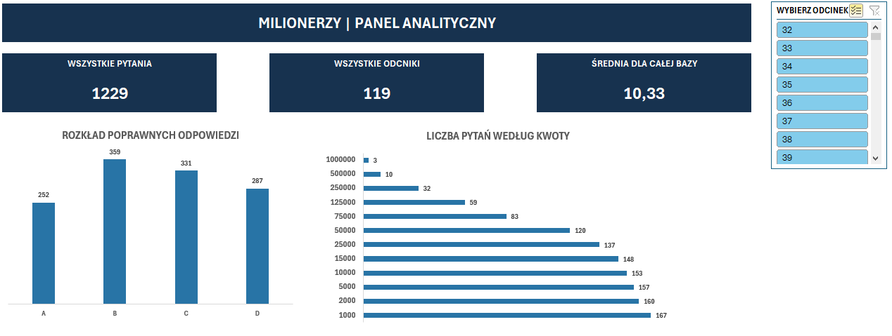
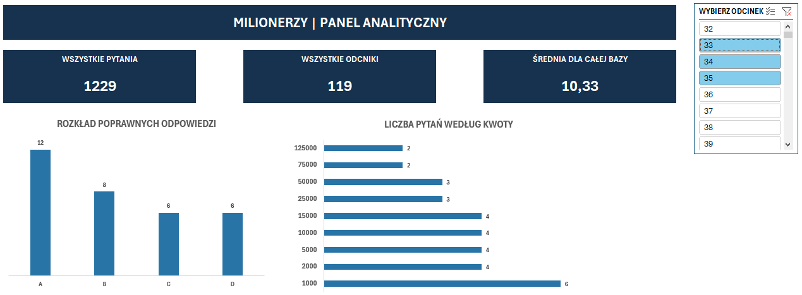

# Automatyzacja pozyskiwania i analizy danych z teleturnieju „Milionerzy”

**Python · Web Scraping · SQLite · CSV · Power Query · Excel · tabele przestawne · kontrola jakości danych · raportowanie PDF**

## 1. Problem i cel

Pytania i odpowiedzi z teleturnieju „Milionerzy” są publikowane w osobnych artykułach na stronie Polsatu. Ręczne zebranie danych z kilkudziesięciu lub kilkuset publikacji jest czasochłonne, a różnice w formatowaniu treści utrudniają ich porządkowanie.

Celem projektu było **zautomatyzowanie procesu — od wyszukania artykułów, przez ekstrakcję i weryfikację danych, aż po przygotowanie raportu analitycznego**.

## 2. Rozwiązanie

Przygotowany w Pythonie system realizuje sześć etapów:

1. **Wyszukiwanie** — automatyczne odnajdywanie artykułów dotyczących kolejnych odcinków.
2. **Ekstrakcja** — pobieranie pytań, wariantów odpowiedzi, poprawnych odpowiedzi i kwot.
3. **Archiwizacja** — zapisywanie uporządkowanych rekordów w SQLite i eksport do CSV.
4. **Kontrola jakości** — wykrywanie brakujących wartości, niespójności i duplikatów.
5. **Analiza statystyczna** — obliczanie rozkładów odpowiedzi, kwot i statystyk odcinków.
6. **Raportowanie** — automatyczne generowanie raportu PDF z tabelami, wykresami i wnioskami.

### Przykład pozyskanych danych

Każde pytanie jest zapisywane jako osobny rekord zawierający numer odcinka, kwotę, treść pytania, cztery warianty odpowiedzi oraz poprawny wariant.

*Fragment uporządkowanego zbioru danych wyeksportowanego do CSV.*

## 3. Rezultaty

| Wskaźnik | Wynik |
|---|---:|
| Przetworzone artykuły | **119** |
| Wyodrębnione pytania | **1 229** |
| Średnia liczba pytań na odcinek | 10,33 |
| Problemy wykryte przez moduł walidacji | 0 |
| Luki w numeracji odnalezionych artykułów | 1 (odcinek 81) |

*Przykładowy przebieg automatycznego pobierania i przetwarzania danych.*

Wszystkie 119 przetworzonych artykułów uzyskało status `ok`. Wynik ten nie stanowi niezależnego potwierdzenia kompletności całego archiwum.

## 4. Kontrola jakości i analiza danych

Moduł walidacji sprawdza kompletność rekordów, poprawność oznaczeń odpowiedzi, zgodność liczby pytań z danymi odcinków oraz występowanie identycznych pytań po normalizacji tekstu.

Na podstawie zgromadzonych informacji program automatycznie przygotowuje raport PDF zawierający statystyki, wykresy i wyniki kontroli jakości.

Przykładowy wynik: w analizowanym zbiorze najczęściej występowała poprawna odpowiedź **B (359 przypadków)**, a najrzadziej **A (252 przypadki)**.

*Fragment raportu PDF wygenerowanego na podstawie danych SQLite.*

**[Zobacz pełny raport analityczny PDF](reports/raport_milionerzy.pdf)**

## 5. Interaktywna analiza danych w Microsoft Excel

Dane zaimportowano do Microsoft Excel za pomocą **Power Query**, a następnie wykorzystano do utworzenia tabel przestawnych i interaktywnego panelu analitycznego.

Dashboard przedstawia liczbę pytań i odcinków, średnią liczbę pytań na odcinek oraz wykresy rozkładu poprawnych odpowiedzi i liczby pytań według kwot.

*Dashboard prezentujący statystyki całego zbioru 1 229 pytań.*

Zastosowanie **fragmentatora** umożliwia jednoczesne filtrowanie obu wykresów według wybranych odcinków, bez konieczności ręcznego przeliczania danych.

*Przykład interaktywnej analizy po wybraniu trzech odcinków. Wykresy aktualizują się zgodnie z zastosowanym filtrem, a wskaźniki u góry przedstawiają statystyki całej bazy.*

Pobierz skoroszyt z interaktywnym dashboardem

Plik zawiera arkusz Dashboard z interaktywną analizą oraz arkusz Milionerzy_Analiza z pełnym zbiorem 1 229 pytań.

## 6. Praktyczne zastosowanie

Projekt pokazuje, jak przekształcić rozproszone informacje internetowe w uporządkowany i weryfikowalny zbiór danych, gotowy do dalszej analizy.

Łączy **automatyzację w Pythonie, kontrolę jakości danych, raportowanie PDF oraz analizę w Excelu**. Zastosowane podejście może być wykorzystane w zadaniach związanych z pozyskiwaniem danych, analizą informacji i przygotowywaniem cyklicznych zestawień.
